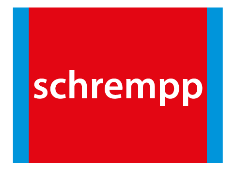
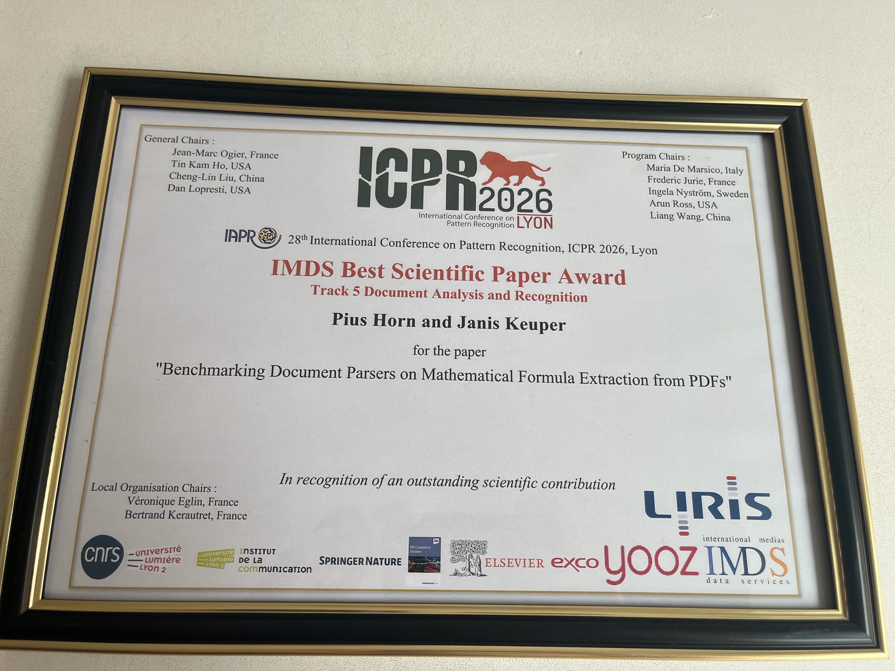

# BMFTR Projekt *LLM-Praxis*
<table>
  <tr>
    <td></td>
    <td></td>
  </tr>
</table>

Laufzeit: 10/24 - 9/28

*KI generiertes Symbolbild: "A small team working with Large Language Models" [Dall-e 3]*

## Projektbeschreibung
Im Kontext von LLMs, wie bei der Einführung vieler anderer disruptiven Technologien, ergeben sich vielfältige wissenschaftliche, technologische, juristische und gesellschaftliche Fragestellungen von große Breite und Tiefe, welche unfraglich ausnahmslos von großer Bedeutung sind, aber unmöglich alle in einem Projekt behandelt werden können. Daher wird sich das vorgeschlagenen Projekt sowohl technologisch, als auch bei der Betrachtung der Technologiefolgen und Rahmenbedingungen auf wenige Kernthemen beschränken, welche in der Frühphase der Erprobung und Entwicklung von LLM Lösungen beim KMUs von hoher praktische Bedeutung sind und Risiken bezüglich anderer Aspekte minimieren.

Im Rahmen von LLMpraxis sollen explizit keine neuen GPT Algorithmen erforscht oder Modelle von Grund auf entworfen oder trainiert werden. Stattdessen soll auf das inzwischen breite Angebot an (unter offenen Lizenzen verfügbaren) sogenannten Foundation-Models  und Open Source Frameworks zurückgegriffen werden, um diese dann an die Anforderungen realer Anwendungen bei den vier Partnerunternehmen anzupassen und produktiv einzusetzen. Neben vielen praktischen Fragestellungen bezüglich des Hostings, APIs zu bestehender Software und der Skalierbarkeit von LLM-Deployments für wachsende Nutzerzahlen auf eigenen lokalen Systemen, soll der wissenschaftliche Fokus im Rahmen einer projektbegleitenden Promotion auf Fragestellungen zur Beschränkung von LLMs auf eigene Daten und deren korrekten Referenzierung (Quellenangabe) liegen. 

Das Herzstück des Projekts ist die anwendungzentrierte Vorgehensweise: gemeinsam mit vier Partnerfirmen wurden fünf konkrete Anwendungen in den zwei grundlegenden Kategorien Coding-Assistent (AP5) und ChatBot (AP6) definiert, welche durch Ihre Anforderungen die Forschung und Entwicklung treiben. Ziel ist es, hier schon frühzeitig im Projekt erste Lösungen in den Realbetrieb zu bringen und so die praktisch relevanten Herausforderung zu erfassen (AP7).

## Partner:
### Forschungseinrichtungen
&nbsp;&nbsp;
&nbsp;&nbsp;
&nbsp;&nbsp;
### Industriepartner
&nbsp;
&nbsp;
&nbsp;&nbsp;
&nbsp;&nbsp;

## Veröffentlichungen 
### Peresse
* [Pressemitteilung zum Projektstart](https://www.hs-offenburg.de/forschung-und-transfer/news-detailseite-forschung-und-transfer/article/ki-technologie-fuer-alle-unternehmen-zugaenglich-machen)

### Wiss. Publikationen
* [Keuper, Janis, "Prompt injection attacks on llm generated reviews of scientific publications", ICPR 26 - ORAL](https://arxiv.org/pdf/2509.10248)
* [Horn, Pius, and Keuper, Janis, "Benchmarking Document Parsers on Mathematical Formula Extraction from PDFs", ICPR 26 - ORAL](https://arxiv.org/pdf/2512.09874) **ICPR Best Paper Award**
* [Lamm, Bianca, and Janis Keuper. "mSOP-765k: A Benchmark For Multi-Modal Structured Output Predictions". Transactions on Machine Learning Research (TMLR), J2C Certification (Top 10% paper), 2026.](https://openreview.net/pdf?id=H7eYL4yFZS) -> Journal2Conference Track at ICML 26
* [Paul Gavrikov, Jovita Lukasik, Steffen Jung, Robert Geirhos, Muhammad Jehanzeb Mirza, Margret Keuper, Janis Keuper, "Can We Talk Models Into Seeing the World Differently?", International Conference on Learning Representations (ICLR) 2025 ](https://openreview.net/pdf?id=iVMcYxTiVM)
* [Lamm, Bianca, and Janis Keuper. "A Visual RAG Pipeline for Few-Shot Fine-Grained Product Classification." Proceedings of the Computer Vision and Pattern Recognition Conference (CVPR) Workshops. 2025.](https://openaccess.thecvf.com/content/CVPR2025W/FGVC/html/Lamm_A_Visual_RAG_Pipeline_for_Few-Shot_Fine-Grained_Product_Classification_CVPRW_2025_paper.html)
  
### Auszeichnungen
* Best Paper Award bei der *International Conference on Pattern Recognition* (ICPR) 2026 in Lyon für unsere Arbeit: [Horn, Pius, and Keuper, Janis, "Benchmarking Document Parsers on Mathematical Formula Extraction from PDFs"](https://arxiv.org/pdf/2512.09874)
&nbsp;&nbsp;

### Open Source Software

[LLameros: a manager for sharing access to local LLMs](https://github.com/keuperj/Llameros/tree/main)

## Kontakt
Prof. Janis Keuper  
Institute for Machine Learning and Analytics  
HS Offenburg  
*janis.keuper* -at- *hs-offenburg.de*   
